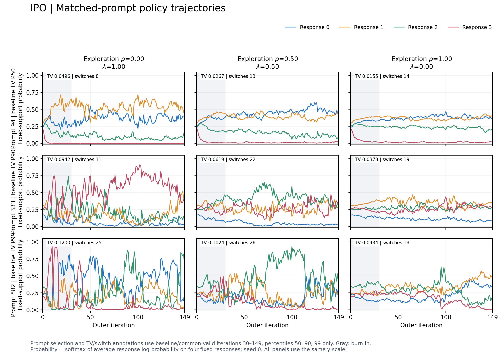
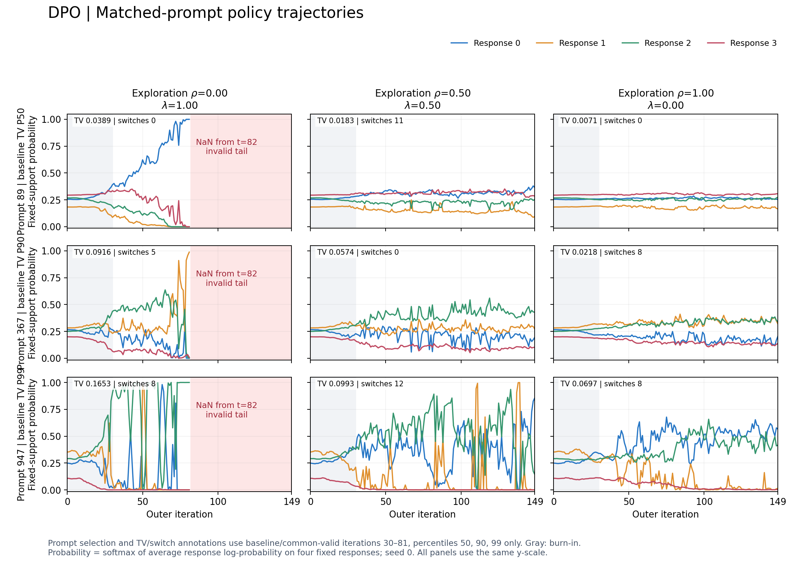

# Historical cyclic sampling ablation (September 11 snapshot)

Published2026-10-13. This is historical **token-average panel probability**,
not current sequence-sum training/results, not Oracle1/2 generated-response WR.
Ten seed0 runs: IPO/DPO each rho=0,.25,.5,.75,1 (lambda=1-rho), alpha=.99.
IPO beta10 and DPO beta1 have different training budgets; compare within each
objective. All500 matched prompts and states0..149 are covered by diagnostics.
The actual historical training commit is unknown; current HEAD is not it.

## What was measured

Fixed cyclic response/pair support, uniform exploration q=(1-rho)*u+rho*U;
pair weights are applied once. Plot probability is softmax of **average**
response log likelihood over four fixed responses. States are pre-update.
These panels are not normalized over unrestricted generation space.

Slurm reported10 completions, but the DPO rho0 baseline has nonfinite scores
from state82 onward. Its old softmax fallback wrote .25 everywhere; this is
an invalid tail, NOT stabilization. Public policy values there are missing.
The first NaN loss was reported within update81. Historical logs remain private.
The other nine runs have finite saved scores. Common-window comparison uses
IPO30..149, DPO30..81 (post-hoc restriction after discovering the failure).

## Descriptive result, not convergence proof

Pure uniform versus rho0 reduces mean adjacent TV by about51.3% for IPO and
71.0% for DPO's restricted valid window. It does not eliminate all fluctuations
or top-response switches. DPO's failed baseline prevents a valid full-horizon
comparison. Single seed; no cross-seed significance or general convergence claim.
Temporal variance also includes drift, not just recurrent oscillation.

## Figures and numeric evidence

- [IPO five settings](figures/ipo_policy_trajectories.pdf), [DPO five settings](figures/dpo_policy_trajectories.pdf)
- [Population diagnostics](figures/population_diagnostics.pdf), [time series](figures/population_time_series.pdf)
- [Run diagnostics](metrics/run_diagnostics.csv), [all500 prompt diagnostics](metrics/prompt_diagnostics.csv)
- [Paired comparisons](metrics/paired_comparisons.csv)
- [Selected policy values](metrics/selected_policy.csv), [population curves](metrics/population_time_series.csv)
- [Provenance and support hashes](provenance.json)

Illustrations select baseline common-window TV percentiles50/90/99, without
looking at intervention benefit: IPO IDs94/333/882, DPO89/367/947. All-prompt
tables retain counterexamples. No raw prompt/response text is included.

The publication script `scripts/publish_results_20261013.py` recomputes all
common-window statistics from the private hash-bound snapshot and checks the
published tables. The snapshot is not shipped because it contains private text
and raw sources. Public curve CSVs can reproduce the displayed numeric curves;
full private-snapshot re-export requires owner access. Invalid values are blank,
never interpolated or replaced by uniform probabilities.
