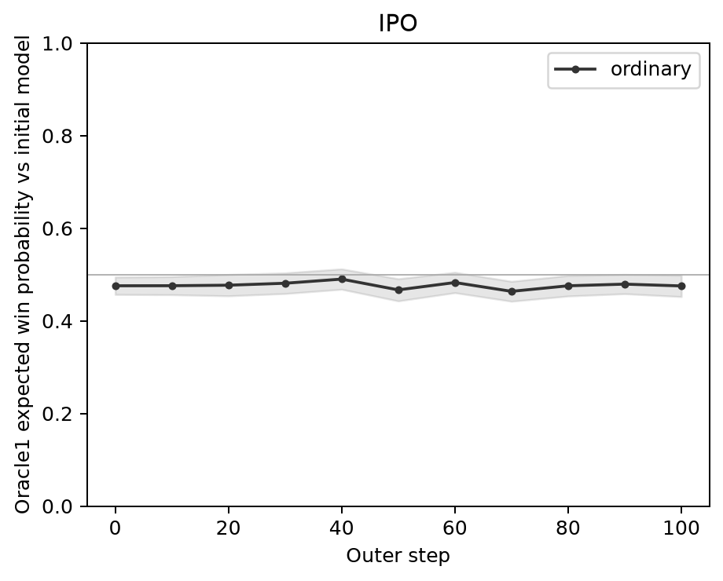

# Qwen3-4B IPO ordinary: completed generated-response WR

Verified October21,2026,22:33 UTC. This is the retained first arm only, not a
six-arm result. Generation4878947 and WR4889849 both COMPLETED, exit0:0.
All9600 answers were scored. The full owner/UID account was empty at22:33:04Z.

## Result

Expected WR is47.569% at state0 and47.536% at state100. The paired change is
-0.033 percentage points, with prompt SE1.163 percentage points. The descriptive
mean +/-1.96 SE interval for that paired change is[-2.312,+2.246] percentage points.
This run does not show a clear improvement from state0 to100. It does not
establish equivalence, convergence, stability across seeds, or human preference.

The highest observed checkpoint mean is49.009% at40; the lowest is46.366% at70.
These are descriptive extrema across11 checkpoints, not a selected best-model
claim or multiplicity-adjusted inference.

[Vector PDF](oracle1_wr.pdf) | [Full-precision summary CSV](wr_summary.csv) |
[Scope](coverage.json) | [Artifact checksums](publication_manifest.json)

The band is mean +/-1.96 prompt SE. It is not training-seed uncertainty.

| Outer state | Expected WR (%) | Prompt SE (percentage points) |
|---|---:|---:|
| 0 | 47.569 | 0.962 |
| 10 | 47.583 | 0.998 |
| 20 | 47.692 | 1.177 |
| 30 | 48.115 | 1.140 |
| 40 | 49.009 | 1.125 |
| 50 | 46.682 | 1.223 |
| 60 | 48.271 | 1.125 |
| 70 | 46.366 | 1.099 |
| 80 | 47.565 | 1.132 |
| 90 | 47.925 | 1.062 |
| 100 | 47.536 | 1.183 |

## Definition and settings

For each of200 held-out evaluation prompts, compare all4 checkpoint answers
with all4 shared initial-Qwen3 baseline answers. Average the16
sigmoid(reward_checkpoint-reward_baseline) probabilities at temperature1,
then average equally across prompts. SE is the sample SD of these200
prompt-level means divided by sqrt(200).

The CSV's historical column name `oracle1_majority_win_rate` denotes the
average hard pair win indicator, with ties valued0.5. It is not a majority
vote across a prompt's16 comparisons. The primary figure uses expected WR.
State0 is not forced to50%: it and the shared baseline use distinct sampled
answer banks under their original canonical seeds.

Qwen3-4B BF16, non-thinking; IPO ordinary, seed0, alpha.9, lambda_current.8,
beta.2, sequence-sum. Training used500 prompts with4 candidates per prompt.
Nemotron Oracle1 only; no Skywork. Generation temperature.8, top_p.95,
top_k0, max_new_tokens256. Scientific settings were not changed.

## Coverage and diagnostics

- Eleven checkpoint banks at0,10,...100 contain800 answers each; shared new-Qwen3
  baseline contains800. Total9600, with zero empty answers.
- Canonical seeds, input/row hashes, bank/journal equality, frozen source and
  all11 checkpoint hashes pass. The old1.5B baseline was not reused.
- Scores cover all9600 objects; identity/input/row hashes and finite rewards
  pass. Rewards range-30.5 to0.984375; maximum judge input1518tokens.
- Recomputed2200 prompt rows and11 summary rows agree with saved tables to
  maximum absolute difference5.56e-17, including both WR metrics and their SEs.
- No logged OOM/Traceback/nonfinite. Generator peak8,645,992,448bytes; final
  scoring progress records peak71,200,515,072 /71,175,622,656bytes across two
  H100s. These are past job peaks, not current allocation.
- Cap256 counts across states0..100 are403,404,407,397,400,397,404,398,398,411,397
  of800; baseline398/800. Roughly half the answers hit the cap. These results
  concern this capped-generation protocol, not unrestricted answer lengths.
- PNG and the rendered one-page PDF were visually inspected. All four downloads
  match server checksums. Git normalizes CSV line endings only; both hashes
  are recorded in the publication manifest.

Only one training seed and one reward-model judge are evaluated. Prompt SE
does not cover training randomness, judge uncertainty or human-rater variation.
All checkpoints share the same baseline bank; the end-minus-start estimate
above is paired by prompt. No five-trait annotation or PCA result is claimed.

## Provenance and reproduction

[Completion audit](../records/ipo_only_wr_complete_20261021.json) |
[Immutable execution route](../IPO_ONLY_EVALUATION.md) |
[Generation receipt](../records/ipo_only_0001_receipt.json) |
[WR receipt](../records/ipo_only_0002_receipt.json)

Training source: `0e7793f5fdd6afdf2fcf80c4ff40649e8926f5a2`.
Retained generation/scoring/plot source: `621b7d706c5c0f43f01250c0c9ca366157a43cd2`.
Binding SHA256:
`0154a2449ed39ace600f798542fae7cd888b5b52fe0593b96e6277de6212e4d6`.
Campaign identity:
`8618a5d85b5a5d5c9d78e84175f02e9745211c488386bcba4757dffdf8ee21f8`.

Run the frozen source's `retained.py --root ROOT --plot --output NEW_DIRECTORY`
against the verified retained root and existing selected-arm tables. It
validates completeness and creates these figures without new GPU scoring.
Remote export: `ipo_runs/oracle1_qwen3_ipo_wr_results_20261021_v1`.
Selected tables remain under original OUTPUT at
`wr/selection_60e18d6565bcad02e1a45cd1f0b49bd18869c9023a30e6e59ea1c960346e513d`.

Other five arms remain withdrawn with their outputs preserved. Eight historical
withdrawn-arm FAILED1:0 outcomes remain failures; none was relabeled. No
all-six completion marker, retraining, other-arm restart or oldOracle2 recovery
was performed. Five-trait annotation remains separately gated by human review.
